<div align="center">


<a href="https://github.com/manthansharma17">
  
</a>

<p>
  <a href="https://github.com/manthansharma17?tab=followers"></a>
  <a href="https://github.com/manthansharma17/manthan_portfolio"></a>
  
</p>

</div>

## 🌑 The Origin

```js
const nightShift = {
  alias: "Manthan Sharma",
  base: "MCA @ IIPS, DAVV, Indore",
  mission: "Build what others think can't be built — then make it look effortless.",
  arsenal: {
    web: ["React", "Next.js", "Node.js", "Express", "MongoDB", "Tailwind"],
    creative: ["Blender", "Unity", "Three.js", "GSAP"],
    intelligence: ["Python", "TensorFlow", "scikit-learn"],
    operations: ["Docker", "n8n", "GitHub Actions", "Linux"],
  },
  hours: "Mostly after midnight",
};
```

> *Some developers wait for the light. I write my best code in the dark.*

- 🏙️ **Full-stack web** — interfaces, APIs and databases, from first pixel to production
- 🧊 **3D & game dev** — modeling and animation in Blender, interactive worlds in Unity
- 🧠 **AI / ML** — training models and wiring intelligence into real products
- ⚙️ **Automation** — n8n workflows that work while I sleep, shipped in Docker containers

## 🛠️ The Arsenal

<div align="center">

**Full-Stack Web**


**3D · Game Dev**


**AI / ML**


**Automation · DevOps · Tools**


<br />


</div>

## 📡 Night Watch

<div align="center">





</div>

## 🚀 Night Patrol: Contributions Under Fire

<div align="center">

<a href="https://manthansharma17.github.io/manthansharma17/game/">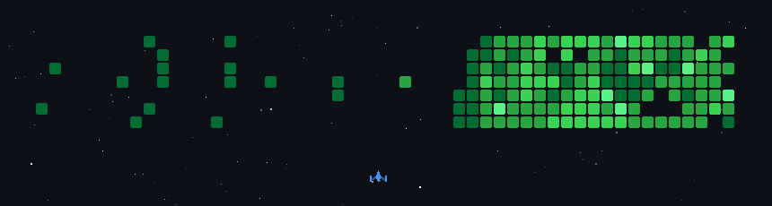</a>

<a href="https://manthansharma17.github.io/manthansharma17/game/"></a>

<sub>Every square is a day of my year. Busier days hit harder. Think you can clear it?</sub>

</div>

## 🗞️ Latest Reports

<!--START_SECTION:activity-->
<!--END_SECTION:activity-->

## 🗂️ Case Files

<div align="center">

<a href="https://github.com/manthansharma17/AuraSnap"></a>
<a href="https://github.com/manthansharma17/dogthreejs"></a>
<a href="https://github.com/manthansharma17/airodynamic-clone"></a>
<a href="https://github.com/manthansharma17/components"></a>
<a href="https://github.com/manthansharma17/IC-2K23-58_AI_ManthanSharma"></a>
<a href="https://github.com/manthansharma17/manthan_portfolio"></a>

</div>

## 🔦 Send a Signal

<div align="center">

<a href="https://github.com/manthansharma17"></a>
<a href="https://github.com/manthansharma17/manthan_portfolio"></a>

<br /><br />

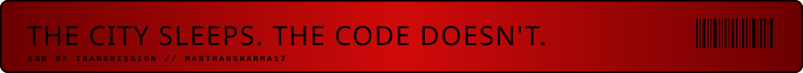

</div>
