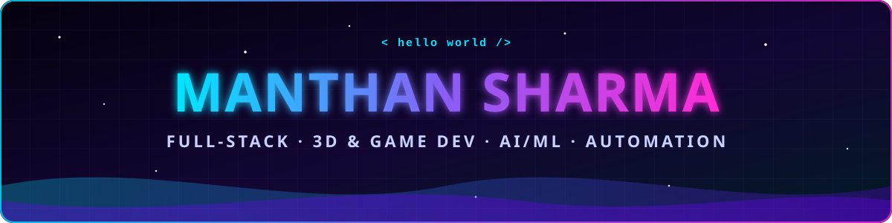

<div align="center">



<a href="https://github.com/manthansharma17">
  
</a>

<p>
  <a href="https://github.com/manthansharma17?tab=followers"></a>
  <a href="https://github.com/manthansharma17/manthan_portfolio"></a>
  
</p>

</div>

## 👨‍🚀 About Me

```js
const manthan = {
  role: "Full-Stack Developer & Creative Technologist",
  education: "MCA @ IIPS, DAVV, Indore",
  building: ["Web apps", "3D experiences", "Games", "AI-powered tools", "Automations"],
  stack: {
    web: ["React", "Next.js", "Node.js", "Express", "MongoDB", "Tailwind"],
    creative: ["Blender", "Unity", "Three.js", "GSAP"],
    ai: ["Python", "TensorFlow", "scikit-learn"],
    ops: ["Docker", "n8n", "GitHub Actions", "Linux"],
  },
  motto: "Ship it, then make it beautiful.",
};
```

- 🌐 I build **full-stack web apps**, from pixel-perfect UIs to APIs and databases
- 🧊 I model and animate in **Blender** and build interactive games in **Unity**
- 🤖 I explore **AI / ML**: training models and bringing intelligent features into real products
- ⚙️ I automate the boring stuff with **n8n** workflows and ship reproducible setups with **Docker**

## 🛠️ Tech Stack

<div align="center">

**Full-Stack Web**


**3D · Game Dev**


**AI / ML**


**Automation · DevOps · Tools**


<br />


</div>

## 📊 GitHub Stats

<div align="center">


</div>

## 🚀 Space Shooter: My Contributions Under Attack

<div align="center">


<sub>Every green square is an enemy. The more I commit, the tougher they get. 👾</sub>

</div>

## ⚡ Recent Activity

<!--START_SECTION:activity-->
<!--END_SECTION:activity-->

## 🌟 Featured Projects

<div align="center">

<a href="https://github.com/manthansharma17/AuraSnap"></a>
<a href="https://github.com/manthansharma17/dogthreejs"></a>
<a href="https://github.com/manthansharma17/airodynamic-clone"></a>
<a href="https://github.com/manthansharma17/components"></a>
<a href="https://github.com/manthansharma17/IC-2K23-58_AI_ManthanSharma"></a>
<a href="https://github.com/manthansharma17/manthan_portfolio"></a>

</div>

## 🤝 Let's Connect

<div align="center">

<a href="https://github.com/manthansharma17"></a>
<a href="https://github.com/manthansharma17/manthan_portfolio"></a>

<br /><br />


</div>
